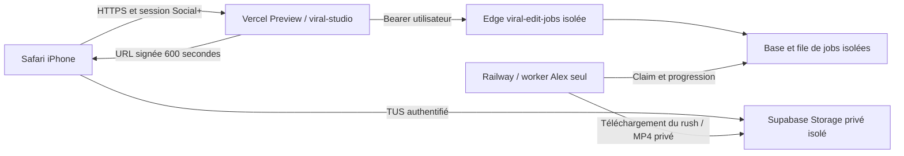

# Social+ connecté — procédure de préproduction Alex V16

**Préparé, non déployé. Budget supplémentaire autorisé : 0 €.**
Aucun changement des six moteurs, de la production ou de la branche PR #58.
L'interface à publier est `viral-studio` (Next.js), jamais l'aperçu statique.

## Architecture retenue



Le worker n'a besoin d'aucun domaine public : il consomme la file et le stockage
via HTTPS sortant. Aucun upload ne traverse une fonction Vercel : les gros fichiers
utilisent le TUS existant, par objets de 40 Mio au-delà de la limite d'un objet.
Les routes Vercel `/api/auth-gateway/*` et `/api/viral-edit-jobs/*` servent le
contrôle et la session, jamais un long rendu FFmpeg ou un stockage local permanent.

## 0 — Geler le code et vérifier les coûts AVANT toute création

Récupérer le commit sauvegardé indiqué dans la livraison, sans pousser la branche :

```sh
git fetch origin COMMIT_SAUVEGARDE
git worktree add --detach ../socialplus-beta COMMIT_SAUVEGARDE
cd ../socialplus-beta
```

Copier `deploy/socialplus-beta/plan.example.json` hors du dépôt. Compléter les
montants UNIQUEMENT à partir de Railway Usage/Billing : crédit inclus restant,
réserve nécessaire à la production jusqu'à la fin du cycle, réserve maximale du
test bêta, coût additionnel **0**, date et référence non secrète de la preuve.
Ne pas diminuer un plafond global : cela pourrait arrêter la production.

```sh
node deploy/socialplus-beta/prepare.mjs /PRIVATE/plan.json /PRIVATE/controle-cout --cost-only
```

Le fichier exemple doit échouer. Le script ne lit pas la facturation du fournisseur
et ne transforme pas des valeurs saisies en preuve de gratuité : il contrôle la
cohérence de montants préalablement vérifiés par le propriétaire. Aucun accès
API de facturation n'est disponible dans la session actuelle. Donc cette étape
est **bloquée aujourd'hui**, avant création et avant toute commande ci-dessous.

La configuration d'une image, les builds, le CPU, la mémoire et les transferts ne
sont pas gratuits par nature. Railway peut n'ajouter aucune facture seulement si
l'usage total reste dans le crédit déjà inclus. Réserver la marge de production et
arrêter la préproduction avant de l'entamer. Un prix de rendu mesuré sur le compte
reste à obtenir ; les 36 secondes locales ne constituent pas un prix Railway.

## 1 — Autorisations nécessaires après confirmation du coût

Autoriser explicitement : un environnement Railway **vide** séparé, un worker
Alex uniquement, un projet Supabase séparé sur l'offre gratuite, le déploiement
Edge de ce seul projet et un déploiement Vercel **Preview**. Aucun abonnement,
volume payant, promotion en production ou migration de Liav CRM.

Le compte Vercel DCEO est Hobby. Employer Preview standard, sans environnement
personnalisé ni option payante. Le projet existant est
`prj_Wkh4h5DSZo3bPfeEMvX7elWkvCZt` / équipe
`team_OHOhV3nnKQdvDgvrBatpGz7O`. Ne pas réassigner ses domaines de production.
Le déploiement historique BLOCKED ne sera ni promu ni utilisé pour ce parcours.

## 2 — Backend de données isolé

1. Créer un projet Supabase **Free**, vérifier les limites et qu'aucun upgrade
   n'est proposé/appliqué. Si l'organisation facture le nouveau projet, arrêter.
   Ne jamais réutiliser `eiypztjpmxdiuaqxjuqx` (Liav CRM).
2. Auth : désactiver les inscriptions publiques. Créer un compte confirmé de
   test, sans droits administrateur. Mot de passe transmis de façon privée ou
   choisi via une invitation, jamais dans Git ou les logs.
3. Préparer le SQL (ne contacte aucune base) :

```sh
node deploy/socialplus-beta/prepare-schema.mjs REF_ISOLE /PRIVATE/schema-beta.sql
```

4. Dans l'éditeur SQL du **nouveau projet vérifié**, examiner puis exécuter ce
   fichier. Il refuse une base possédant déjà les tables applicatives. Il combine
   les migrations existantes avec deux tables historiques minimales nécessaires
   aux clés étrangères/quota ; ces tables restent vides, Analyse est désactivée.
   Il traite explicitement le changement historique de type de retour du RPC de
   jobs, dans la transaction fraîche seulement. Ce bootstrap est spécifique à la
   bêta Alex ; il ne reconstitue pas les fonctions historiques d'Analyse.
5. Vérifier `media_assets`, `processing_jobs`, `job_events`, `edit_projects`,
   `edit_timelines`, `edit_exports`, le RPC de claim et leurs politiques RLS.
6. Vérifier le bucket privé `viralplus-videos`, limite par objet 50 000 000 octets,
   chemins préfixés par l'UUID du propriétaire, politiques d'accès propriétaire.
   L'API impose 200 000 000 octets par vidéo ; la limite gratuite de stockage total
   du compte s'applique aussi. Ne pas activer R2 pour ce premier test.

Le SQL généré a été appliqué sur PostgreSQL 17 local avec des prérequis
Auth/Storage de test ; les quatre politiques ajoutées ont été vérifiées, et une
seconde application a été refusée. Il n'a pas été appliqué
à un nouveau projet distant dans cette préparation. Vérifier son exécution avant
la création du worker. Ne jamais contourner un échec en désactivant RLS.

## 3 — Worker Railway dédié, sans toucher aux services existants

Dans `viral-edit` (`eff635d8-91ad-49f7-b53b-45748b7500f8`) :

1. Créer un environnement **vide**, par exemple `socialplus-alex-beta`.
   Ne pas dupliquer les quatre services de production ni leurs secrets.
2. Créer un seul service vide dans cet environnement, après validation du coût.
   Aucun domaine, volume ou source Git à déploiement automatique n'est nécessaire.
3. Configurer ce seul service : contexte de build `/`, Dockerfile
   `deploy/socialplus-beta/Dockerfile`, une seule réplique, healthcheck `/ready`. Ne pas redéployer pendant un rendu :
   attendre une file vide et arrêter ce seul worker avant une mise à jour pour
   éviter le chevauchement temporaire de deux versions.
   Ne pas modifier le Dockerfile/configuration du `video-worker` de production.
4. Variables privées du worker :
   - `SUPABASE_URL` : URL du projet isolé.
   - `SUPABASE_SERVICE_ROLE_KEY` : clé privée de ce projet, injectée dans Railway.
   - `SOCIALPLUS_ALEX_ONLY=true`.
   - `ALEX_V16_RECONSTRUCTION_ENABLED=true`, `ALEX_V16_REVIEW_DRAFTS=true`.
   - `WORKER_ID=socialplus-alex-private-beta`, `POLL_MS=2500`.
   L'image définit Python et le répertoire Whisper. Aucune clé Gemini ni R2.
5. Noter les IDs de l'environnement et du service dans le plan privé. IDs interdits :
   environnement `c65ec871-c63f-442e-b39c-6abed0823cf0`, services de production
   `df3cab36-c2d4-466b-823c-ec5895685074`, `4a63fa3c-1839-4856-9fb9-59ccde9d478d`,
   `d973da1e-25d1-46e6-a46c-6b2e616ccbaf`, `3747de69-b1b3-4fc4-98ed-66a8f982d31e`.

L'image dédiée conserve le chemin Alex Python/Pillow/FFmpeg, sans Chromium ni
préchargement Remotion inutile pour ce chemin. Les sources originales restent
présentes. Le mode d'admission refuse les autres jobs avant téléchargement média.
Whisper small est téléchargé publiquement à une révision immuable, avec quatre
SHA-256 identiques aux fichiers déjà testés. Aucun rush n'entre dans l'image.
L'image elle-même n'a pas encore été construite/testée sur Railway.

## 4 — Contrôle complet du plan avant activation

Confirmer l'isolation, le schéma, le bucket et l'inscription fermée dans le plan :

```sh
node deploy/socialplus-beta/prepare.mjs /PRIVATE/plan.json /PRIVATE/controle-activation
```

Cette commande refuse production, base partagée, répliques multiples, coûts
inconnus, preuve périmée ou supplément positif. Elle ne déploie rien.
Un résultat positif ne remplace pas la lecture des cibles dans les tableaux de bord.

## 5 — Commandes d'activation, UNIQUEMENT après accord explicite

Les commandes suivantes ne sont pas exécutées dans cette préparation. Se connecter
aux CLI avec OAuth ; ne jamais coller de token dans Git ou passer de clé privée
sur la ligne de commande. Les IDs ne sont pas des secrets.

Déployer le worker depuis la racine du worktree avec les IDs isolés vérifiés :

```sh
npx --yes @railway/cli@5.23.3 up . --project eff635d8-91ad-49f7-b53b-45748b7500f8 --environment ID_ENV_ISOLE --service ID_SERVICE_ISOLE --detach
```

Attendre le statut final SUCCESS et un `/ready` interne sain. `--detach` ne prouve
pas que le déploiement est terminé. Vérifier les variables, le modèle et l'absence
d'erreur de claim. Arrêter ce seul service si le budget réservé est atteint.

Déployer la fonction dans le **projet Supabase isolé** :

```sh
npx --yes supabase@2.122.0 functions deploy viral-edit-jobs --project-ref REF_ISOLE
```

Supabase fournit lui-même `SUPABASE_URL` et `SUPABASE_SERVICE_ROLE_KEY` dans Edge.
Ne pas tenter de les définir comme secrets préfixés `SUPABASE_`. Les secrets Edge
à définir dans ce seul projet sont `SOCIALPLUS_ALEX_ONLY=true`,
`ALEX_V16_RECONSTRUCTION_ENABLED=true` et `ALLOWED_ORIGIN=URL_PREVIEW_EXACTE`.
Conserver la validation de session utilisateur dans la fonction ; ne jamais
contourner une erreur d'authentification pour faire passer le test.

Dans Vercel, configurer **Preview uniquement** avec `preview.env.example` :
URL et clé publique du projet isolé, `NEXT_PUBLIC_ALEX_V16_REVIEW_ENABLED=true`,
`NEXT_PUBLIC_SOCIALPLUS_ALEX_ONLY=true`. Aucune clé service-role dans Vercel.
L'application refuse le mode bêta s'il retombe sur l'URL de production.

Depuis la racine du worktree, publier l'application Next complète :

```sh
export VERCEL_ORG_ID=team_OHOhV3nnKQdvDgvrBatpGz7O
export VERCEL_PROJECT_ID=prj_Wkh4h5DSZo3bPfeEMvX7elWkvCZt
npx --yes vercel@65.4.0 deploy --cwd viral-studio --local-config "$(pwd)/deploy/socialplus-beta/vercel.json" --scope dceo --yes
```

Ne pas ajouter `--prod`, ne pas promouvoir, ne pas réassigner de domaine. Le
fichier local force Next.js pour ce déploiement et ne publie pas l'aperçu statique.
Attendre READY puis recopier son URL unique HTTPS dans les redirections Auth et
`ALLOWED_ORIGIN` Edge. Vérifier qu'il est bien classé Preview avant tout test.
Laisser la protection Vercel activée ; le propriétaire peut devoir se connecter
à Vercel puis à son compte Social+. Ne pas générer de lien de contournement public.

## 6 — Recette qui autorise l'envoi de l'URL au propriétaire

1. Safari physique : login Social+, import Photos/Fichiers d'un MOV, statut réel
   TUS, fin d'upload confirmée par la base et le stockage, format natif conservé.
2. Alex sélectionnable et seul modèle lançable ; analyse/autres modèles refusés
   par l'API et le worker, pas seulement masqués dans l'interface.
3. Transcription locale → file → progression réelle → MP4 disponible avant
   completed. L'avertissement de transcription non validée reste visible.
4. Lire le MP4 avec son audio original, télécharger vers Fichiers, rouvrir le
   résultat. Vérifier le fichier H.264/AAC, une piste audio et le format natif.
5. Deux comptes : accès au job/export de l'autre refusé ; sans session 401.
   Mauvais CSRF n'est pas le mécanisme de cette API Bearer : vérifier les tokens
   Supabase, l'ownership serveur et la confidentialité du stockage.
6. Tester fichier vide, session expirée, coupure réseau, panne de rendu et quota
   stockage : aucune fausse réussite, possibilité de réessayer.
7. Relever coût/CPU/mémoire/temps réels de ce rendu Railway puis arrêter la
   préproduction après le créneau si son maintien n'entre pas dans la réserve.

Le contrôle navigateur Linux antérieur ne valide pas Safari physique. Les trois
MP4 conservés et les mots à écouter restent inchangés. La suppression automatique
des objets Storage à 24 h n'est pas implémentée : limiter cette première session
au propriétaire et gérer explicitement l'effacement dans le stockage isolé avant
une bêta multi-utilisateurs prolongée. Ne pas annoncer de rétention automatique.

## Blocages actuels et repli

Le crédit/plafond Railway et la marge après consommation de production ne sont
pas accessibles via les outils connectés. Aucun environnement/compte test distant
n'est créé. Le coût zéro n'est donc pas confirmé et cette procédure reste arrêtée
à l'étape 0. L'accès en lecture de ces montants ou une preuve privée du propriétaire
est nécessaire ; aucun secret de facturation n'est demandé dans la conversation.

Si l'usage inclus Railway s'avère insuffisant, une instance Oracle Always Free
ARM 2 OCPU/12 Go est un repli techniquement plausible pour cette image CPU sans
Chromium, avec stockage/Auth isolés. Son compte, sa capacité gratuite, le build
ARM64 et un vrai rendu restent à valider. Aucune migration ni activation de ce
repli n'est lancée ; Vercel/Railway ne sont pas déclarés inutilisables.

## Vérifications exécutées sur cette préparation

- 81 tests Node réussis : worker existant, admission Alex et validation du plan.
- Un test navigateur de contrat vérifie Alex sélectionné et les autres modèles
  désactivés (session simulée explicitement, aucun upload ni rendu prétendu).
- Build Next réussi avec mode bêta et URL/clé publique factices de build isolé ;
  aucun compte ou upload distant créé par ce build.
- Démarrage réel du worker : `/ready` retourne 503 si les poids manquent, sans
  demander de clé Gemini dans le mode Alex seul.
- Handler Edge réel lancé localement : backend de production connu refusé avant
  toute requête de session ou base ; permissions réseau Deno limitées au loopback.
- Manifeste Whisper vérifié contre les quatre fichiers publics déjà disponibles.
- Générateur SQL exécuté sur PostgreSQL 17 local avec fixtures Auth/Storage,
  protections de non-réexécution vérifiées. Pas une validation cloud Supabase.
- Image Docker complète non construite ; rendu avec cette image et recette Safari
  distants non exécutés. Les précédents rendus et essais réels ne sont pas présentés
  comme une validation de ce futur déploiement.

### Vérification exécutable des variables, de la session, du bucket et des routes

Après préparation du projet isolé et de sa fonction Edge, créer **hors Git** un
fichier privé de variables (permissions 600) avec `BETA_SUPABASE_URL`,
`BETA_SUPABASE_PUBLIC_KEY`, `BETA_SUPABASE_SERVICE_KEY` et `BETA_TEST_CREDENTIALS`
(chemin d'un JSON privé contenant email/password du compte isolé). Ne pas copier
une clé de production, ne pas transmettre ce fichier ni l'état de session en artefact.

```sh
node --env-file=/PRIVATE/backend.env deploy/socialplus-beta/verify-backend.mjs /PRIVATE/plan.json
```

Ce contrôle vérifie les valeurs de coût déjà confirmées, refuse le backend partagé,
lit la configuration Auth/bucket/schéma, ouvre une vraie session de test, contrôle
401 sans session et l'API de stockage authentifiée, puis vérifie le refus d'Analyse
avant de fermer la session. Il ne crée pas de média, ne réclame aucun job et ne
lance aucun rendu. Il n'a pas été exécuté sur un backend distant dans cette session,
faute de projet isolé et de coût confirmé. Il ne remplace pas les tests d'ownership
entre deux comptes et le parcours complet sur iPhone.
